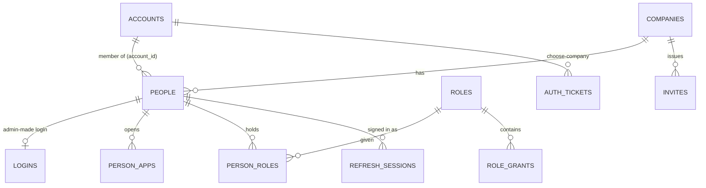
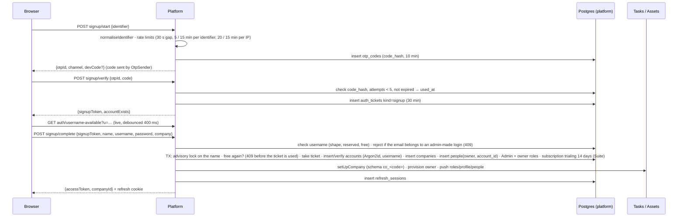

# Low-level design: registration and login

Platform service (`services/platform`, NestJS + Drizzle, Postgres schema `platform`). Everything below is what the code does
as of 2026-10-21 (PLAN.md §13, §21, §21.5, §19.24, §19.28). All routes are under `/api/platform`. Tasks and Assets never see
passwords; they only verify the signed access token.

## 1. Modules and classes

| Module / file | Class / function | Responsibility |
|---|---|---|
| `accounts/identifier.ts` | `normaliseIdentifier()` | Email → lower-case; Indian mobile (10 digits, optional `+91`/`0`) → `+91XXXXXXXXXX`; anything else → null |
| `accounts/username.ts` | `usernameShape()`, `usernameTaken()`, `lockUsername()`, `assertUsernameFree()` | Account usernames (§21.5): shape + reserved words, "free" across `accounts.username`, `logins.username` and employee IDs, advisory lock per name, per-IP check limit |
| `accounts/otp.service.ts` | `OtpService` | 6-digit codes: `start()` (send, rate-limit), `verify()` (check, count attempts, optionally consume) |
| | `TicketsService` | Short-lived single-use tickets: `signup` (proves the identifier, 30 min) and `login` (choose-company step, 5 min) |
| | `OtpSender` / `FakeOtpSender` | Delivery interface. Fake = Platform log (+ `devCode` in the response only with `OTP_DEV_ECHO=1` or `DEMO_MODE=1`) |
| `accounts/accounts.service.ts` | `AccountsService` | Sign-up (`signupStart/Verify/Complete`), new company for an account, forgot / reset password, `usernameAvailable`, `setUsername` |
| `accounts/accounts.controller.ts` | controllers | HTTP layer, Zod validation, throttles |
| `auth/auth.service.ts` | `AuthService` | Sign-in (`login`, `loginAccount`, `loginWithTicket`), `switchCompany`, `issueFor`, `refresh`, `logout`, `revokeAll`, `me`, `changePassword` |
| `auth/auth.controller.ts` | controller | `auth/*` routes; sets / clears the refresh cookie (web) or returns it in the body (`client: 'mobile'`) |
| `auth/auth.guard.ts` | `AuthGuard` | Reads `Authorization: Bearer <access>`, verifies it, loads the caller |
| `auth/throttle.ts` | `Throttle` | In-memory counters: per IP for sign-in (`LOGIN_IP_LIMIT`, default 1000 / 15 min); account lock only if `LOGIN_MAX_FAILED` > 0 (default 0 = off) |
| `keys/keys.service.ts` | `KeysService` | Ed25519 key pairs; private key encrypted with `PLATFORM_SECRET`; public keys at `/.well-known/jwks.json` |
| `keys/tokens.service.ts` | `TokensService` | `signAccess()` / `verifyAccess()` (EdDSA JWT, 15 min); `signService()` (60 s, Platform → app internal calls) |
| `invites/invites.service.ts` | `InvitesService` | Invite links: create, list, revoke, info, accept |
| `company/setup.service.ts` | `SetupService` | Creates the company in Tasks and Assets and pushes roles / profile / people |

## 2. Data model (identity part)

| Table | Key columns | Notes |
|---|---|---|
| `accounts` | `id` uuid PK, `email`, `mobile`, `username`, `full_name`, `password_hash`, `failed_logins`, `locked_until`, `last_login_at`, `password_changed_at`, `is_staff` | Global person who signed themselves up or joined by invite. Email and mobile unique (case-insensitive). `username` (migration 0013) nullable, stored lower-case, unique index on `lower(username)`; also never equal to a `logins.username` or an employee ID (checked in code, §4.7) |
| `people` | `id` uuid PK, `company_id` FK, `account_id` FK (nullable), `full_name`, `employee_code`, `email`, `mobile`, `platform_role` (`owner`/`admin`/`member`), `status`, department, reports-to, … | One row per person **per company** (= a membership). Employee code unique per company |
| `logins` | `person_id` PK/FK, `username` (unique, case-insensitive), `password_hash`, `failed_logins`, `locked_until`, `last_login_at`, `password_changed_at` | Admin-made login for one person in one company (username / employee ID) |
| `person_apps` | (`person_id`, `app`) PK, `local_user_id` | Which apps the person can open and their user id inside that app |
| `roles`, `role_grants`, `person_roles` | role kind `role` / `owner` / `personal` | What the person may do (Admin, Member, custom roles, hidden owner + personal extra-access roles) |
| `refresh_sessions` | `id` = sha256(refresh token) PK, `family_id`, `person_id`, `client`, `expires_at`, `rotated_at`, `revoked_at`, `ip`, `user_agent` | One row per refresh token; rotation keeps the same family |
| `otp_codes` | `id` uuid PK, `target`, `channel` (`email`/`sms`), `purpose` (`signup`/`reset`/`login`), `code_hash` = sha256(id:code), `attempts`, `expires_at`, `used_at`, `ip` | 10-minute codes, 5 attempts |
| `auth_tickets` | `id` = sha256(ticket) PK, `kind` (`signup`/`login`), `target`, `channel`, `account_id`, `expires_at`, `used_at` | Single use |
| `invites` | `id`, `company_id`, `token_hash` (unique), `role_ids[]`, `apps[]`, `expires_at`, `max_uses`, `uses`, `revoked_at`, `created_by` | Token itself is never stored |
| `signing_keys` | `kid` PK, `public_jwk`, `private_enc`, `active` | Private key encrypted at rest |

Passwords: **Argon2id** (`m=19456, t=2, p=1`, random salt per hash) in `accounts.password_hash` / `logins.password_hash`.
Imported Tasks users keep their Django `pbkdf2_sha256$…` hash until their first sign-in, when it is re-hashed with Argon2id.
Never stored or logged in clear; no reversible copy (project rule).



## 3. API

| Method + path | Auth | Request | Response |
|---|---|---|---|
| `POST signup/start` | public | `{identifier}` | `{otpId, channel, devCode?}` · 429 `{message, retryAfterSeconds}` |
| `POST signup/verify` | public | `{otpId, code}` | `{signupToken, accountExists}` · 400 wrong / expired / too many tries |
| `POST signup/complete` | public | `{signupToken, fullName?, username?, password, company:{name, teamSize, industry, state, apps}}` (`fullName` + `username` required for a new account) | sign-in response + `{companyId, provisionMs, setupIncomplete?}` · 409 `{field:'username', message, errors:{username}}` taken · 409 `{field:'companyName', message, errors:{companyName}}` company name taken (§4.8) · 400 invalid / reserved |
| `GET companies/name-available?n=&rename=1?` | public (optional bearer) | — | `{available, reason?: 'taken' / 'invalid', message}` · 429 after 60 / min per IP; `rename=1` + bearer: the caller's own company counts as free |
| `GET auth/username-available?u=` | public (optional bearer) | — | `{available, reason?: 'taken' / 'invalid' / 'reserved', message, username?}` · 429 after 60 / min per IP |
| `PUT auth/username` | bearer (account) | `{username}` | `{ok, username}` · 409 taken · 400 invalid / reserved · 403 admin-made login |
| `POST auth/login` | public | `{login, password, client?}` or `{ticket, companyId, client?}` | sign-in response, or `{chooseCompany:[{companyId,name,code,role}], ticket}` · 401 wrong · 402 suspended · 429 network limit |
| `POST auth/refresh` | refresh cookie / body | `{refreshToken?}` (mobile) | new sign-in response (rotated refresh) |
| `GET auth/companies` | bearer | — | `[{companyId, name, code, role, current}]` |
| `POST auth/switch` | bearer | `{companyId}` | sign-in response for that company |
| `POST companies` | bearer (account) | company fields | sign-in response for the new company · 409 `{field:'companyName', …}` name taken |
| `POST auth/forgot` | public | `{identifier}` | `{otpId, channel, devCode?}` (same answer whether the account exists or not) |
| `POST auth/reset/verify` | public | `{otpId, code}` | `{ok:true}` (counts an attempt, does not consume) |
| `POST auth/reset` | public | `{otpId, code, newPassword}` | `{ok:true}`; all sessions of the account are revoked |
| `GET invites/:token` | public | — | `{companyName, roles, apps, expiresAt, valid, reason?, message?}` |
| `POST invites/:token/accept` | bearer (account) or `{signupToken, fullName?, username?, password}` | | sign-in response for that company · 410 invalid · 402 no seat · 409 username taken |
| `GET/POST invites`, `DELETE invites/:id` | bearer + Manage people | `{roleIds, apps, expiresInDays, maxUses}` | `{id, token, url}` |
| `POST auth/change-password` | bearer | `{currentPassword, newPassword}` | `{ok}`; other sessions revoked |
| `POST auth/logout` · `auth/logout-all` | refresh / bearer | | 204 |
| `GET auth/me` | bearer | | person, company, apps, permissions, `account` (`{id, email, mobile, username, isStaff}`), `billing` |
| `GET .well-known/jwks.json` | public | | Ed25519 public keys (used by Tasks and Assets) |

**Sign-in response:** `{accessToken, expiresIn: 900, refreshToken?}` — `refreshToken` only in the body for `client:'mobile'`;
web clients get it as an `HttpOnly`, `SameSite=Lax` cookie (`Secure` when `COOKIE_SECURE` is not `false`), path `/api/platform/auth`.

**Access token (JWT, EdDSA, 15 min):** `sub` = person id, `cid` = company id, `name`, `role` (platform role), `apps`
(`{tasks: localUserId, assets: localUserId}`), `fam` (refresh family), `ro: true` while the company is read-only, `iss`
`freefounders-platform`, `aud` `freefounders`, `kid` header.

## 4. Flows

### 4.1 Registration (self sign-up)

Rules: password ≥ 6 characters (weak passwords warned in the web, never refused); a new account chooses a username (§4.7;
the web suggests one from the name); an existing account gives only its password (its username is kept) and gets a second company; at most a few new companies per account per day; app set-up failure → the user is
still signed in, `setupIncomplete: true`, and the Platform retries after 30 s, 2 min, 10 min.

### 4.2 Login
```mermaid
sequenceDiagram
  participant U as Browser
  participant P as Platform
  participant DB as Postgres
  U->>P: POST auth/login {login, password}
  P->>P: per-IP throttle (1000 / 15 min)
  P->>DB: account by email / mobile, or (not an email / mobile) by accounts.username; else logins.username / people.employee_code
  alt admin-made login
    P->>P: verifyPassword (Argon2id or Django PBKDF2 → re-hash)
  else account
    P->>P: verifyPassword(accounts.password_hash)
    P->>DB: memberships = people where account_id and status active and company open
    alt several companies
      P->>DB: insert auth_tickets kind=login (5 min)
      P-->>U: {chooseCompany:[…], ticket}
      U->>P: POST auth/login {ticket, companyId}
    end
  end
  P->>P: company suspended? only the owner continues (read-only)
  P->>DB: reset failed_logins, last_login_at · insert refresh_sessions
  P-->>U: {accessToken (15 min)} + refresh cookie (1 year, sliding)
```
Wrong password and unknown user give the same 401 after the same dummy Argon2 check (no user enumeration).
Failed attempts are counted but never lock (`LOGIN_MAX_FAILED=0`).

### 4.3 Staying signed in (refresh rotation)
`POST auth/refresh` with the cookie → look up `refresh_sessions.id = sha256(token)` → must be unrevoked, unexpired, not
rotated → mark `rotated_at`, insert a new row in the same `family_id`, return a new access token and refresh token.
A token already rotated more than 60 s ago is replayed theft → the whole family is revoked. A person switched off, a
password reset or `logout-all` revokes every family of that person or account at once.

### 4.4 Switch company / new company
`POST auth/switch {companyId}` → the caller must have an account and an active membership there → `issueFor(thatPerson)`
→ new access + refresh (new family). `POST companies` creates a company for the signed-in account (same steps as 4.1
after the ticket) and signs into it. The web empties its query cache on every switch so no data from the other company
is shown.

### 4.5 Forgot / reset password
`auth/forgot` → OTP purpose `reset` (same limits; same answer for unknown identifiers) → `auth/reset/verify` checks the
code without consuming it → `auth/reset` checks and consumes it, sets the new Argon2id hash, clears failures, revokes all
sessions of the account; the web then signs in with the new password. Admin-made logins (username / employee ID) are
reset by an admin in People, not by code.

### 4.6 Invite link
Admin creates a link (`token` 32 random bytes, only `sha256` stored; roles limited by "you can give only what you hold";
apps limited to the company's plan). `GET invites/:token` shows company and roles. Accept: signed-in account → new
`people` row with `account_id` (or reuse an existing membership); new person → `signup/start` + `verify` first, then
accept with the `signupToken` + name + username + password (409 on the field when the username was just taken). Seat limit checked → 402. `uses` +1; expired / revoked / used-up → 410
with the reason.

### 4.7 Usernames of accounts (§21.5)
- **Shape:** 3–30 characters, `^[a-z][a-z0-9._-]{2,29}$` after lower-casing: starts with a letter (so never all digits: no
  clash with a mobile number or a numeric employee ID), no `@` (never an email). Stored lower-case.
- **Reserved:** admin, administrator, owner, support, help, staff, root, system, sysadmin, superuser, moderator,
  freefounders (and anything starting with `freefounders` or `admin`), api, www, mail, security, billing, login, signup,
  console, settings, tasks, assets, attendance, me, null, … (`RESERVED_USERNAMES`). Only account usernames are checked
  against the list: the existing admin-made login `owner` keeps working.
- **One namespace:** a name is free only if no account (`accounts.username`), no admin-made login (`logins.username`) and
  no employee ID (`people.employee_code`, any company) uses it, case-insensitive; the account's own memberships do not
  count. Enforced in code inside the transaction after `pg_advisory_xact_lock(hashtext('ff-username:<name>'))`, plus the
  unique index `accounts_username_uq` (a race ends in 409, `exception.filter.ts`). Admin-made logins (People → create /
  set login) and employee IDs refuse a name an account holds: 409 "This username is already taken. Try another." (logins),
  400 (employee ID).
- **Messages:** taken "This username is already taken. Try another." · invalid "Use 3–30 letters, numbers, dots, - or _,
  starting with a letter." · reserved "This username is reserved."
- **Availability:** `GET auth/username-available` (public, 60 per minute per IP, `USERNAME_CHECK_IP_LIMIT`); it reveals
  whether a name exists (accepted, `docs/security/platform.md` §7). Signed in, the caller's own name counts as free.
- **Change:** `PUT auth/username` for a signed-in account (the web: /account → Username); one name for all its companies.
- **Existing accounts** got no username (they add one on /account); their email / mobile keep working.

### 4.8 Company names are unique (§21.6)
- **Rule:** no two companies share a name, compared after trimming, collapsing inner whitespace and lower-casing
  ("Test  Comp" = "test comp"); every company counts (there is no deleted state). 2–80 characters after trimming. New
  names are stored trimmed with single spaces (`services/platform/src/company/company-name.ts`).
- **Where:** `signup/complete` and `POST companies` (inside the transaction that inserts the company, so a refusal uses
  nothing up: the sign-up token and username stay free), `PATCH company` (Settings) when the name really changes (saving
  the current name, in any case, is always allowed), and the CLI `company -- create`.
- **Race-safe:** `pg_advisory_xact_lock(hashtext('ff-company-name:<normalised>'))` then the lookup, in the same
  transaction; two sign-ups with the same name at once → one 200, one 409. No unique index: deployed databases already
  hold duplicates (two "testcomp" on the server), which stay as they are and keep loading, signing in and saving.
- **Answer:** 409 `{field:'companyName', message:'A company called "<name>" already exists. If you work there, ask its
  owner for an invite link.', errors:{companyName}}`; 400 for the length.
- **Availability:** `GET companies/name-available?n=` (public, 60 per minute per IP, `COMPANY_NAME_CHECK_IP_LIMIT`).
  `rename=1` with a sign-in (Settings): the caller's own company is not counted. Without it (sign-up, New company) it is.
- **Web:** the company step of sign-up, /new-company and Admin → Settings check the name 400 ms after typing stops
  ("Available" or the message under the field); Create / Save stay disabled while it is taken, too short / long or being
  checked; a 409 at submit returns to the field with the message.

## 5. How the apps trust the token
- **Tasks (Django):** `accounts/platform_auth.py` verifies the JWT against the Platform JWKS (cached), maps `cid` to the
  company schema (`TENANCY=schemas`) and `apps.tasks` to the local user; writes refused with 402 when `ro`.
- **Assets (NestJS):** `POST /api/auth/platform-session` exchanges the token for its own 15-minute session cookie (keeps
  `read_only`) so photos and downloads work with plain `` / links.
- **No company in the token → the empty `ff_none` schema** (fail closed).

## 6. Limits and settings

| Setting | Default | Meaning |
|---|---|---|
| Access token | 15 min | `ACCESS_TTL_SECONDS` |
| Refresh token | 365 days, sliding | rotated on every use; 60 s grace for parallel tabs |
| OTP | 6 digits, 10 min, 5 tries | 30 s between codes, 5 per identifier and 20 per IP per 15 min (`OTP_IP_LIMIT`) |
| Signup ticket / choose-company ticket | 30 min / 5 min | single use |
| `LOGIN_MAX_FAILED` | 0 (no lock) | > 0 brings back a 15-minute lock after that many wrong passwords |
| `LOGIN_IP_LIMIT` | 1000 per 15 min | per-network bot guard |
| `OTP_DEV_ECHO` / `DEMO_MODE` | off | show the code on screen (test and demo only) |
| `COOKIE_SECURE` | true | set `false` only for a plain-http demo |
| `PLATFORM_SECRET` | required in production | encrypts the signing keys |

## 7. Not built yet
Real OTP delivery (SMS / WhatsApp / email: replace `FakeOtpSender`), CAPTCHA after suspicious attempts, Google sign-in,
authenticator codes for admins, "Where you're signed in" screen, audit log of sign-ins, https on the demo server.
