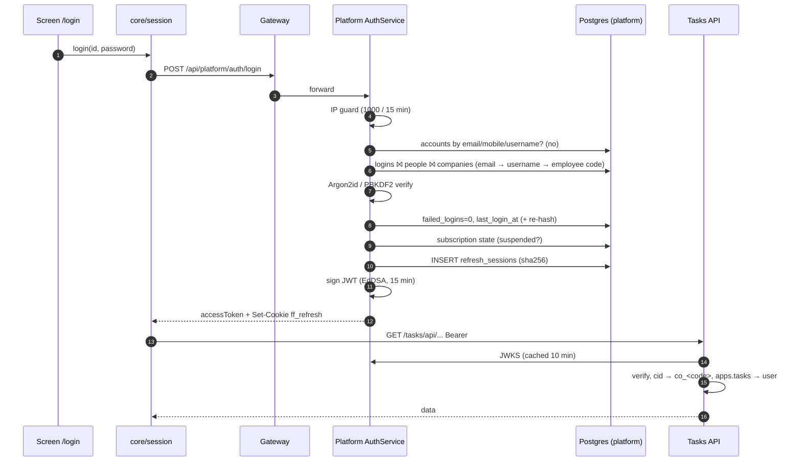
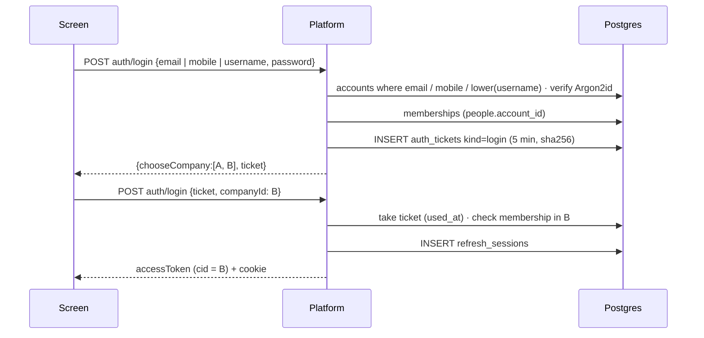

# Low-level design: the complete sign-in flow

From the moment a person presses **Sign in** until Tasks and Assets answer their first request, and how the session
stays alive afterwards. Traced from the code (2026-10-21). Related: `docs/LLD-registration-login.md` (tables, API list).

**Code map**

| Layer | File | What it does in sign-in |
|---|---|---|
| Screen | `apps/web/src/app/pages/login.tsx`, `features/account/choose-company.tsx`, `features/account/code-sign-in.tsx` | Form, errors, company chooser, redirect; "Sign in with a code instead" (`/login?code=1`) |
| Client session | `packages/core/src/session.ts` | `login()`, `loginWithCode()`, `loginWithTicket()`, `refresh()`, access token kept in memory |
| Client HTTP | `packages/core/src/http.ts` | Adds `Authorization: Bearer`, on 401 refreshes once and retries |
| Gateway | `infra/gateway/dev-gateway.mjs` (dev), `infra/deploy/Caddyfile` (server) | `/api/platform/*` → Platform :4000 |
| Controller | `services/platform/src/auth/auth.controller.ts` | `POST auth/login`, `auth/refresh`, cookie handling |
| Service | `services/platform/src/auth/auth.service.ts` | `login()` → `loginAccount()` / admin-made path → `issueFor()` |
| Helpers | `auth/throttle.ts`, `accounts/identifier.ts`, `accounts/otp.service.ts` (`TicketsService`) | Network limit, identifier normalising, choose-company ticket |
| Tokens | `keys/tokens.service.ts`, `keys/keys.service.ts` | Sign the 15-minute JWT (Ed25519), publish JWKS |
| Apps | `services/tasks/backend/accounts/platform_auth.py`, `services/assets/apps/api/src/modules/auth/*` | Verify the token, pick the company schema, map to the local user |

---

## Phase 1 — Screen (browser or phone app)

1. `/login` shows **Email, mobile, username or employee ID** and **Password**. "Username" means an account's own
   username (§21.5) or an admin-made login's username.
2. On submit the screen calls `session.login(login, password)` (packages/core).
3. `session.login` → `POST /api/platform/auth/login` with
   `{ login, password, client }` and header `X-Requested-With: XMLHttpRequest`.
   `client` is `'web'` in browsers and `'mobile'` only for a native client that stores the refresh token itself
   (the Android app is the web app in a WebView, so it is `'web'` and uses the cookie).

**Sign in with a code instead** (PLAN.md §21.8): the link under the button opens `/login?code=1` (keeps `?next`).
Email or mobile of an account → **Send code** → `POST auth/login/code/start {identifier}` (`useLoginCodeStart`) →
"Enter your code" (code field, test-mode note when `devCode` came back, live resend countdown) → **Sign in** →
`session.loginWithCode(otpId, code)` → `POST auth/login/code/verify {otpId, code, client}`. The answer is the same as
`auth/login` (tokens + cookie, or `{chooseCompany, ticket}` → Phase 6). A username or employee ID is refused on the
screen and by the server with "sign in with your password". Server side: `AccountsService.loginCodeStart/Verify`
(OTP purpose `login`, all code limits; the per-IP sign-in guard; a wrong code counts like a wrong password) →
`AuthService.loginVerifiedAccount` (= Phase 5B without the password). Delivery: `OTP_SENDER` (fake / MSG91, see
`docs/LLD-registration-login.md` §4.9).

## Phase 2 — Gateway
4. The gateway (one address, :8080 locally / :7395 on the server) forwards `/api/platform/*` unchanged to the Platform
   (:4000) with `X-Forwarded-For` / `-Proto` / `-Host`. No CORS: page and API share one origin.

## Phase 3 — Controller `POST auth/login`
5. Body contains `ticket`? → second step of a company choice (Phase 6). Otherwise validate with Zod `loginSchema`
   (`login` 1–200 chars, `password` 1–200 chars, `client` web|mobile) → 400 if invalid.
6. Call `AuthService.login(login, password, {ip, userAgent, client})`.

## Phase 4 — `AuthService.login`: who is it?
7. **Network guard:** `throttle.blocked('ip:<ip>', LOGIN_IP_LIMIT=1000 per 15 min)` → **429** "Too many sign-in attempts
   from this network…". (Only failed attempts count.)
8. **Is it an account identifier?** `normaliseIdentifier(input)`:
   - contains `@` and looks like an email → `{kind:'email', value: lower-case}`
   - 10-digit Indian mobile (optional `+91` / `0` / spaces) → `{kind:'mobile', value:'+91XXXXXXXXXX'}`
   - otherwise → null.
   If it normalised: `SELECT * FROM platform.accounts WHERE lower(email)=$1` (or `mobile=$1`) LIMIT 1.
   Otherwise, if it has the shape of a username (`^[a-z][a-z0-9._-]{2,29}$` after lower-casing):
   `SELECT * FROM platform.accounts WHERE lower(username)=$1` LIMIT 1 (PLAN.md §21.5).
   Found → **account path (Phase 5B)**. Account and admin-made usernames are one namespace (checked when either is set),
   so at most one of them matches.
9. **Admin-made login lookup** (`findLogin`), in this order, joining `logins → people → companies`:
   1. contains `@` → `lower(people.email) = lower($1)`; exactly one match required (an email in two companies is ambiguous);
   2. `lower(logins.username) = lower($1)`;
   3. `lower(people.employee_code) = lower($1)`; exactly one match required.
10. **Not found, person switched off, or company not active** → run a dummy Argon2 verify (same time cost as a real
    one, so nobody can tell), count a failure for the network, **401** "The email, mobile number, username or password is
    not right…". (With `LOGIN_MAX_FAILED` > 0 a per-name counter would also answer "locked"; default 0 = off.)

## Phase 5A — Admin-made login: check the password
11. `verifyPassword(logins.password_hash, password)`:
    - `$argon2id$…` → Argon2id verify (`@node-rs/argon2`);
    - `pbkdf2_sha256$…` (imported from the old Tasks app) → PBKDF2-SHA256 with the stored salt/iterations,
      constant-time compare.
12. Wrong → `UPDATE logins SET failed_logins = failed_logins + 1` (information only), network failure +1, **401**.
    (If `LOGIN_MAX_FAILED` > 0: one attempt is claimed atomically *before* the check, and the account locks for 15 min
    after that many wrong tries → 401 "locked".)
13. Right → `UPDATE logins SET failed_logins=0, locked_until=NULL, last_login_at=now()` and, for an imported PBKDF2
    hash, `password_hash = argon2id(password)` (silent upgrade).
14. `assertOpen(company)`: subscription `suspended` and the person is not the owner → **402** "This company's
    subscription is suspended…". → go to **Phase 7** with this person.

## Phase 5B — Account (email / mobile / username): check the password, pick the company
15. Same network guard; `verifyPassword(accounts.password_hash, password)`; wrong → `failed_logins + 1`, **401**;
    right → `failed_logins=0, last_login_at=now()`.
16. `memberships(accountId)`: `people` rows with this `account_id`, `status='active'`, company `active`, joined with
    the company name/code, the person's platform role and the subscription state.
17. Keep the companies that are open (`state != 'suspended'`, or the person is that company's owner).
    - none open but some exist → **402** suspended; none at all → **403** "Your account is not part of any company yet…";
    - exactly one → **Phase 7** with that person;
    - several → **Phase 6**.

## Phase 6 — Choose a company (accounts in 2+ companies)
18. `TicketsService.create('login', 5 min, {accountId})`: 32 random bytes; only `sha256(ticket)` is stored in
    `platform.auth_tickets`.
19. Response **200** `{ chooseCompany: [{companyId, name, code, role}], ticket }` — no tokens yet, no cookie.
20. The screen shows the company list (`choose-company.tsx`). The person picks one →
    `session.loginWithTicket(ticket, companyId)` → `POST auth/login {ticket, companyId, client}`.
21. `loginWithTicket`: take the ticket (must exist, kind `login`, unused, not expired → `used_at=now()`; otherwise
    **401** "Please sign in again"; the screen tells the person the 5-minute choice ran out), check the account has an open membership in that company,
    then **Phase 7** with that person.

## Phase 7 — Issue the session (`issueFor(personId)`)
22. `familyId = randomUUID()` — one family per sign-in (one device / browser).
23. **Refresh token:** 32 random bytes (base64url). `INSERT platform.refresh_sessions (id=sha256(token), family_id,
    person_id, client, expires_at=now()+365 days, ip, user_agent)`. Only the hash is stored.
24. **Caller:** `people ⨝ companies ⨝ subscriptions` + `person_apps` →
    `{personId, companyId, name, role, apps:{tasks: localUserId, assets: localUserId} (only apps the company has on),
    sessionFamily, readOnly}`.
25. **Access token:** `TokensService.signAccess(caller)` → JWT, header `{alg:'EdDSA', kid, typ:'JWT'}`, claims
    `sub, cid, name, role, apps, fam, ro?`, `iss 'freefounders-platform'`, `aud 'freefounders'`, `iat`, `exp = +15 min`,
    `jti`. Signed with the active Ed25519 private key (stored encrypted with `PLATFORM_SECRET`, decrypted in memory).

## Phase 8 — Response and what the client keeps
26. Controller `respondTokens`:
    - **web:** `Set-Cookie: ff_refresh=<token>; HttpOnly; SameSite=Lax; Path=/api/platform/auth; Max-Age=1 year`
      (`Secure` unless `COOKIE_SECURE=false` on the http demo); body `{accessToken, expiresIn: 900, mustChangePassword:false}`;
    - **mobile:** body also has `refreshToken`; the app keeps it in secure storage.
27. `session` keeps the **access token in memory only** (never localStorage), decodes its claims (company, role, apps,
    `ro`) and notifies listeners; the saved query cache of another company is dropped.
28. The screen loads `GET auth/me` (person, company, permissions, apps, account, billing) and goes to `next` or Home
    (on phones: `/attendance`).

## Phase 9 — First request to Tasks / Assets
29. Every API call (`packages/core/src/http.ts`) sends `Authorization: Bearer <access>` and `X-Requested-With`.
30. **Tasks** (`accounts/platform_auth.py`): read `kid` → fetch/cached JWKS from the Platform (10 min cache) → verify
    EdDSA signature, `iss`, `aud`, `exp` → `cid` picks the company schema `co_<code>` (`SET search_path`, no company →
    empty `ff_none`) → `apps.tasks` is the local user id → permissions from the synced roles. A write while
    `ro: true` → **402**.
31. **Assets:** the web first calls `POST /assets/api/auth/platform-session` with the token → Assets verifies it the same
    way and sets its own 15-minute `HttpOnly` session cookie (keeps `read_only`), so `` photos and downloads work.

## Phase 10 — Staying signed in
32. Before / when the 15 minutes run out a request gets **401** → `http.ts` calls `session.refresh()` once (one renewal
    shared by all parallel requests) → `POST auth/refresh` (cookie; mobile sends the token in the body).
33. `AuthService.refresh`: `refresh_sessions` row by `sha256(token)` must exist, not revoked, not expired; the person must
    still be active, company active, still have a login or account, company not suspended (owners excepted) — else the
    family is revoked and **401** "Please sign in".
34. **Rotation:** atomically set `rotated_at=now()` on the old row; the winner inserts a new row in the same family and
    returns a new refresh token (new cookie) + new access token. A parallel tab within 60 s just gets a new access token.
    The same old token presented more than 60 s after rotation = copied → **revoke the whole family**, 401.
35. Sliding: each rotation gives another 365 days, so an active person stays signed in.

## Phase 11 — Signing out and forced sign-out
36. `POST auth/logout` → revoke this refresh row's family, clear the cookie; the in-memory access token is dropped.
37. `POST auth/logout-all`, password change / reset, the person switched off, exit completed → revoke **every** family of
    the person (or of the account). Existing access tokens die within ≤ 15 minutes; the Platform's `AuthGuard` checks on every
    request that the token's family (`fam`) is still live, so Platform endpoints stop at once.
38. Hourly clean-up removes expired / revoked sessions; codes and tickets older than a day are deleted.

---

## Sequence (admin-made login, one company)

## Sequence (account in two companies)

## Decision table

| Situation | Answer |
|---|---|
| Too many failed attempts from one network (1000 / 15 min) | 429, retry later |
| Unknown name, switched-off person, inactive company | 401 (same text and timing as a wrong password); the web adds "Signed up yourself? Use the email, mobile number or username you chose." |
| Account username (any case) | account path: one company → tokens, several → `chooseCompany` |
| Username of an admin-made login | admin-made path (unchanged) |
| Wrong password | 401, counted, never locked (unless `LOGIN_MAX_FAILED` > 0) |
| Email used by people in two companies (admin-made logins) | 401 (ambiguous): sign in with username or employee ID |
| Account with no company | 403 "not part of any company yet" |
| Company suspended, not the owner | 402 "subscription is suspended" |
| Company suspended, owner | signs in, `ro: true`, web opens Billing |
| Company read-only (past due ended) | signs in, `ro: true`; every write → 402 |
| Account in one open company | tokens at once |
| Account in several open companies | `chooseCompany` + 5-minute ticket |
| Ticket used, expired or wrong company | 401 "Please sign in again" (the 5-minute choice ran out), start again |
| Code sign-in with a username / employee ID | 400 "…sign in with your password" |
| Code sign-in, wrong code | 400 "Wrong code. N tries left." (5 per code), counts toward the per-IP guard |
| Code sign-in, no account for the verified email / mobile | 400 "There is no Kaampilot account…" (only after the code; the start answer is identical) |
| Code sign-in, email of an admin-made login | 400 "This email signs in with a login your company admin made. Sign in with your password instead." |
| Code could not be sent (MSG91 refused / down / not set up) | 400 "We couldn't send the code. Check the number and try again." / 503; the code is never usable and the person may ask again at once |

## Timings and sizes
Access token 15 min · refresh token 365 days sliding, 60 s rotation grace · choose-company ticket 5 min · JWKS cache in
apps 10 min · Argon2id `m=19456 KiB, t=2, p=1` (≈ 50–100 ms per check on the server) · refresh and ticket tokens 32
random bytes, stored as SHA-256 · cookie path limited to `/api/platform/auth` so it is never sent to Tasks or Assets.
